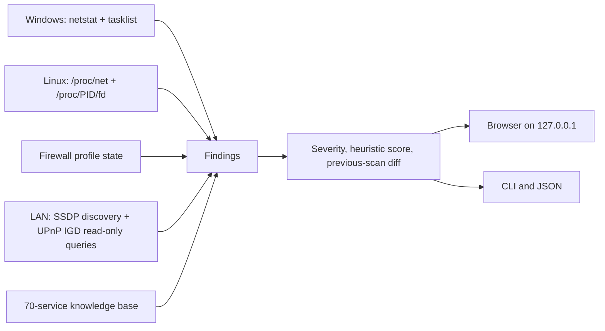

<div align="center">

# PortScope

**Audit the network exposure of your own Windows or Linux machine and the port mappings reported by your router.**

Defensive cybersecurity · Local-first · No runtime Python packages · English and Spanish

[](https://github.com/IvelianK/Port-Scope/actions/workflows/ci.yml)
[](https://github.com/IvelianK/Port-Scope/releases/latest)
[](LICENSE)

[Documentación en español](README_es.md) · [Download a release](https://github.com/IvelianK/Port-Scope/releases/latest) · [Report a vulnerability privately](SECURITY.md)

</div>

PortScope is a **defensive cybersecurity tool** for finding services listening on your computer, identifying their owning processes, and inspecting the port forwards a Universal Plug and Play (UPnP) Internet Gateway Device reports. It explains what a finding means and suggests reversible checks and mitigations. It does not probe arbitrary Internet hosts, change firewall or router settings, or send reports to a cloud service.

## What PortScope tells you

| Question | What it checks | Important limit |
| --- | --- | --- |
| Which ports are listening? | TCP listeners and bound UDP sockets, with address and process where available | A bound UDP socket is not proof that a remote host can reach it |
| Can another machine reach a service? | Whether it binds to loopback or a network address | Local firewall rules are not inspected per port |
| Did the router publish a port? | Enabled UPnP IGD mappings, including mappings to other LAN devices | A mapping suggests possible external exposure; it is not an outside-in connectivity test |
| Why does it matter? | A database of 70 services, risk notes in two languages, and relevant MITRE ATT&CK links | A port number does not prove which application protocol actually runs there |
| What changed? | A diff against the previous comparable scan | The history contains finding IDs and severity, not a full report |

PortScope also shows a heuristic score and an operating-system-specific guide for each finding. The guide proposes commands for you to review; PortScope never runs them.

## Download and run v2.0.2

Download files from the [v2.0.2 release](https://github.com/IvelianK/Port-Scope/releases/tag/v2.0.2). The executable builds target x64 Windows and x64 Linux. No Python installation is needed for these files.

### Windows

1. Download `portscope-windows-x64.exe` and `SHA256SUMS.txt` into the same folder.
2. Compare the digest shown by PowerShell with the entry for the executable in `SHA256SUMS.txt`:

   ```powershell
   Get-FileHash .\portscope-windows-x64.exe -Algorithm SHA256
   ```

3. Double-click `portscope-windows-x64.exe`, or run it from PowerShell:

   ```powershell
   .\portscope-windows-x64.exe
   ```

The app prints a local URL and opens your browser. Keep the terminal window open while using the dashboard. Stop it with **Quit** or `Ctrl+C`. The binary is currently unsigned, so Windows may show an unknown publisher warning. Verify the release before deciding whether to run it; do not disable security protections.

### Linux

1. Download `portscope-linux-x64.tar.gz` and `SHA256SUMS.txt` into the same directory.
2. Compare the digest shown by `sha256sum` with the archive's entry in `SHA256SUMS.txt`, then extract and run it:

   ```bash
   sha256sum portscope-linux-x64.tar.gz
   tar -xzf portscope-linux-x64.tar.gz
   ./portscope
   ```

The archive preserves the executable bit. The Linux binary is built on Ubuntu 22.04; other distributions may need newer compatible system libraries. If it does not start, use the Python source method below. PyInstaller does not bundle `glibc`.

### Verify who built a release file

GitHub Actions publishes a SHA-256 manifest and signed build provenance. If you have [GitHub CLI](https://cli.github.com/) installed, verify the downloaded file against this repository:

```bash
gh attestation verify ./portscope-linux-x64.tar.gz --repo IvelianK/Port-Scope
```

On Windows, replace the path with `.\portscope-windows-x64.exe`. A matching SHA-256 proves the file matches the published manifest; provenance verifies which GitHub workflow built it. Neither is a substitute for reviewing the source and security updates.

### Run from source

Use Python 3.10 or newer. The application needs no third-party Python packages at runtime:

```bash
git clone https://github.com/IvelianK/Port-Scope.git
cd Port-Scope
git checkout v2.0.2
python3 -m portscope
```

On Windows, use `py -3 -m portscope` for the last command. Run as a normal user first. Elevated privileges may reveal more process owners on some systems, but they are not needed to open the dashboard. Under `sudo`, PortScope prints the URL instead of launching a browser as root.

## How the audit works

PortScope collects local socket information and, unless you disable UPnP, asks devices on your LAN for their UPnP descriptions. It queries Internet Gateway Devices for their reported port mappings. It makes no outbound connection to test a port from the public Internet.



| Label | How PortScope assigns it | How to interpret it |
| --- | --- | --- |
| `local` | The service listens only on a loopback address | Not reachable directly through a normal network interface; still relevant to local threats |
| `network` | The service listens on a non-loopback address | Could be reachable on the LAN, subject to firewall and routing |
| `internet` | An enabled UPnP mapping targets a matching local listener, or reports a forward to another host | **Potential** external exposure; verify from outside and check double NAT, carrier-grade NAT, and firewall rules |

A mapping that points to this computer but has no matching listener is reported separately as a router configuration finding. Disabled mappings do not make a local listener `internet`-exposed. Manual router forwards do not appear in UPnP results.

Severity combines the service's baseline risk with this exposure label. The score starts at 100 and applies bounded penalties for findings, an enabled firewall state, and the presence of a UPnP gateway. It is a **triage aid**, not a vulnerability scan, compliance result, or proof that a host is safe. The firewall estimate does not parse individual rules; the exact formula is in [analysis.py](portscope/analysis.py).

## Command-line use

The standalone executable accepts the same options as `python3 -m portscope`:

```bash
./portscope --cli --no-upnp
./portscope --json --no-history > scan.json
./portscope --fail-on high --no-upnp
./portscope --no-browser
./portscope --help
```

| Option | Effect |
| --- | --- |
| `--cli` | Print a text report |
| `--json` | Print a full JSON report, including process names and any detected public IP |
| `--no-upnp` | Skip discovery and router requests on the LAN |
| `--no-history` | Do not read or write the local scan history |
| `--fail-on high` | Exit with code 2 if a high or critical finding exists |
| `--no-browser` | Keep the browser closed; use the URL printed in the terminal |
| `--port N` | Bind the dashboard to a chosen port on `127.0.0.1` only |

On Windows, replace `./portscope` with `.\portscope-windows-x64.exe`. Without `--no-history`, PortScope stores only the data needed for the next diff in `~/.portscope/last_scan.json`. Treat full JSON exports as sensitive: they can contain your external IP, LAN devices, addresses, and process names.

## Security boundaries and limitations

The dashboard binds to `127.0.0.1`, validates the `Host` header, requires a per-run token for API calls, and sends a restrictive Content Security Policy. The browser receives a single-use launch code; the terminal prints a URL containing the token. Do not share that URL or the report. UPnP responses are untrusted: PortScope validates mapping fields, restricts description URLs to the responding private address, and limits response size and time. See [SECURITY.md](SECURITY.md) for private vulnerability reporting.

PortScope cannot prove public reachability, see manual router forwards, interpret every firewall rule, identify the protocol behind every port number, or detect vulnerabilities inside a service. It supports Windows and Linux; macOS is not supported. Scan only systems and networks you own or are authorized to assess.

## Develop and contribute

Run the standard-library test suite from a checkout:

```bash
python3 -m unittest -v
python3 -m portscope --cli --no-upnp --no-history
```

Port metadata lives in [ports.json](portscope/data/ports.json); translations live in [web/i18n](portscope/web/i18n). See [CONTRIBUTING.md](CONTRIBUTING.md) before opening a pull request; behavior changes need tests. The [release workflow](.github/workflows/release.yml) builds tagged commits from `main`, tests both executables, publishes SHA-256 checksums and attests the build.

## License

PortScope is available under the [MIT License](LICENSE).
