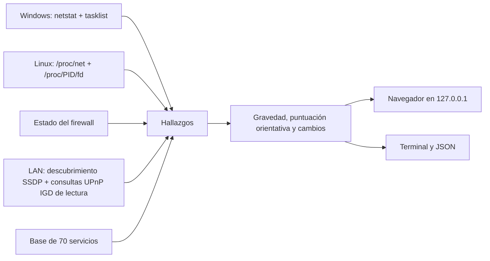

<div align="center">

# PortScope

**Audita la exposición de red de tu equipo Windows o Linux y los reenvíos de puertos que declara tu router.**

Ciberseguridad defensiva · Análisis local · Sin paquetes Python en tiempo de ejecución · Español e inglés

[](https://github.com/IvelianK/Port-Scope/actions/workflows/ci.yml)
[](https://github.com/IvelianK/Port-Scope/releases/latest)
[](LICENSE)

[English documentation](README.md) · [Descargar una versión](https://github.com/IvelianK/Port-Scope/releases/latest) · [Comunicar una vulnerabilidad en privado](SECURITY.md)

</div>

PortScope es una **herramienta de ciberseguridad defensiva**. Identifica los servicios que escuchan en tu equipo y sus procesos, y consulta los reenvíos que declara un router compatible con Universal Plug and Play (UPnP). Explica cada hallazgo y propone comprobaciones y mitigaciones reversibles. No sondea equipos arbitrarios de Internet, no cambia el firewall ni el router y no envía informes a servicios en la nube.

## Qué averigua PortScope

| Pregunta | Qué comprueba | Límite importante |
| --- | --- | --- |
| ¿Qué puertos están en escucha? | Puertos TCP y sockets UDP vinculados, con dirección y proceso cuando está disponible | Un socket UDP vinculado no demuestra que sea accesible desde fuera |
| ¿Puede llegar otro equipo al servicio? | Si escucha en loopback o en una dirección de red | No analiza las reglas del firewall puerto a puerto |
| ¿Ha publicado el router algún puerto? | Reenvíos activos declarados por UPnP IGD, incluso a otros equipos de la LAN | Un reenvío indica posible exposición; no es una prueba de conectividad desde Internet |
| ¿Por qué importa? | Base de 70 servicios, explicaciones bilingües y enlaces relevantes a MITRE ATT&CK | El número de puerto no demuestra qué protocolo de aplicación se está usando |
| ¿Qué ha cambiado? | Comparación con el último análisis equivalente | El histórico guarda identificadores y gravedad, no el informe completo |

PortScope también muestra una puntuación orientativa y una guía por sistema operativo para cada hallazgo. Tú decides si ejecutas sus comandos; PortScope nunca los ejecuta.

## Descargar y ejecutar v2.0.2

Descarga los archivos de la [versión v2.0.2](https://github.com/IvelianK/Port-Scope/releases/tag/v2.0.2). Los ejecutables están preparados para Windows x64 y Linux x64. No necesitan Python instalado.

### Windows

1. Descarga `portscope-windows-x64.exe` y `SHA256SUMS.txt` en la misma carpeta.
2. Compara el resultado de PowerShell con la línea del ejecutable en `SHA256SUMS.txt`:

   ```powershell
   Get-FileHash .\portscope-windows-x64.exe -Algorithm SHA256
   ```

3. Haz doble clic en `portscope-windows-x64.exe` o ejecútalo desde PowerShell:

   ```powershell
   .\portscope-windows-x64.exe
   ```

La aplicación muestra una URL local y abre el navegador. Mantén abierta la terminal mientras uses el panel. Ciérrala con **Salir** o `Ctrl+C`. El ejecutable todavía no está firmado, por lo que Windows puede mostrar «Editor desconocido». Verifica la versión antes de decidir si lo ejecutas; no desactives las protecciones del sistema.

### Linux

1. Descarga `portscope-linux-x64.tar.gz` y `SHA256SUMS.txt` en el mismo directorio.
2. Compara el hash con la línea del archivo en `SHA256SUMS.txt`. Después extráelo y ejecútalo:

   ```bash
   sha256sum portscope-linux-x64.tar.gz
   tar -xzf portscope-linux-x64.tar.gz
   ./portscope
   ```

El archivo conserva el permiso de ejecución. El binario Linux se compila en Ubuntu 22.04; otras distribuciones pueden necesitar bibliotecas del sistema compatibles o más recientes. Si no arranca, usa el método con Python de abajo. PyInstaller no incluye `glibc`.

### Comprobar el origen de un ejecutable

GitHub Actions publica un manifiesto SHA-256 y una declaración firmada del proceso de compilación. Si tienes [GitHub CLI](https://cli.github.com/), comprueba el archivo descargado:

```bash
gh attestation verify ./portscope-linux-x64.tar.gz --repo IvelianK/Port-Scope
```

En Windows, sustituye la ruta por `.\portscope-windows-x64.exe`. El SHA-256 comprueba que el archivo coincide con el manifiesto publicado. La declaración de procedencia identifica el workflow de GitHub que lo compiló. Ninguna de las dos sustituye la revisión del código ni las actualizaciones de seguridad.

### Ejecutarlo desde el código fuente

Necesitas Python 3.10 o posterior. La aplicación no necesita paquetes Python de terceros durante su ejecución:

```bash
git clone https://github.com/IvelianK/Port-Scope.git
cd Port-Scope
git checkout v2.0.2
python3 -m portscope
```

En Windows, usa `py -3 -m portscope` en la última línea. Empieza con un usuario normal. Los privilegios elevados pueden mostrar más procesos en algunos sistemas, pero no hacen falta para abrir el panel. Si lo lanzas con `sudo`, PortScope imprime la URL en lugar de abrir el navegador como root.

## Cómo hace el análisis

PortScope recoge la información local de sockets. Si no desactivas UPnP, busca dispositivos en tu LAN y consulta a los routers IGD los reenvíos que declaran. No conecta desde Internet para probar la accesibilidad de los puertos.



| Etiqueta | Cuándo se asigna | Cómo interpretarla |
| --- | --- | --- |
| `local` | El servicio solo escucha en loopback | No se alcanza directamente por una interfaz de red normal; los riesgos locales siguen existiendo |
| `network` | El servicio escucha en una dirección distinta de loopback | Podría alcanzarse desde la LAN, según el firewall y el enrutamiento |
| `internet` | Un reenvío UPnP activo apunta a un servicio local compatible o a otro equipo | Exposición externa **potencial**; compruébala desde fuera y revisa doble NAT, CGNAT y firewall |

Si un reenvío apunta a este equipo pero no hay un servicio que escuche en la dirección de destino, aparece como hallazgo de configuración del router. Los reenvíos desactivados no convierten en exposición a Internet un servicio local. Los reenvíos manuales del router no aparecen en UPnP.

La gravedad combina el riesgo base del servicio y la exposición estimada. La puntuación parte de 100 y aplica penalizaciones limitadas por hallazgo, por el estado del firewall y por la presencia de un router UPnP. Es una **ayuda para priorizar**, no un análisis de vulnerabilidades, una certificación ni una prueba de que el equipo esté seguro. La estimación del firewall no lee cada regla; la fórmula exacta está en [analysis.py](portscope/analysis.py).

## Uso desde la terminal

El ejecutable descargado acepta las mismas opciones que `python3 -m portscope`:

```bash
./portscope --cli --no-upnp
./portscope --json --no-history > scan.json
./portscope --fail-on high --no-upnp
./portscope --no-browser
./portscope --help
```

| Opción | Función |
| --- | --- |
| `--cli` | Muestra un informe de texto |
| `--json` | Genera un informe JSON completo, con nombres de procesos y la IP pública si se detectó |
| `--no-upnp` | Omite el descubrimiento y las consultas al router en la LAN |
| `--no-history` | No lee ni escribe el histórico local |
| `--fail-on high` | Devuelve el código 2 si hay un hallazgo alto o crítico |
| `--no-browser` | No abre el navegador; usa la URL que aparece en la terminal |
| `--port N` | Usa un puerto concreto, solo en `127.0.0.1` |

En Windows, sustituye `./portscope` por `.\portscope-windows-x64.exe`. Sin `--no-history`, PortScope guarda solo los datos necesarios para la próxima comparación en `~/.portscope/last_scan.json`. Trata los informes JSON como datos sensibles: pueden contener IP pública, equipos de la LAN, direcciones y procesos.

## Límites y seguridad

El panel escucha en `127.0.0.1`, valida la cabecera `Host`, exige un token nuevo en cada ejecución y aplica una política de seguridad de contenido restrictiva. El navegador recibe un código de arranque de un solo uso; la terminal imprime una URL con el token. No compartas esa URL ni el informe. PortScope trata las respuestas UPnP como datos no fiables: valida los reenvíos, limita las URL al respondedor privado y restringe el tamaño y el tiempo de respuesta. Consulta [SECURITY.md](SECURITY.md) para comunicar vulnerabilidades en privado.

PortScope no puede confirmar la accesibilidad desde Internet, descubrir reenvíos manuales, interpretar todas las reglas del firewall, identificar el protocolo real de cada puerto ni detectar fallos dentro de un servicio. Funciona en Windows y Linux; macOS no está soportado. Analiza únicamente equipos y redes propios o para los que tengas autorización.

## Desarrollo y contribuciones

Ejecuta los tests desde el repositorio:

```bash
python3 -m unittest -v
python3 -m portscope --cli --no-upnp --no-history
```

La base de puertos está en [ports.json](portscope/data/ports.json) y las traducciones en [web/i18n](portscope/web/i18n). Lee [CONTRIBUTING.md](CONTRIBUTING.md) antes de abrir una pull request; los cambios de comportamiento necesitan tests. El [workflow de publicación](.github/workflows/release.yml) compila etiquetas de `main`, prueba ambos ejecutables y publica hashes SHA-256 y una declaración de procedencia.

## Licencia

PortScope se distribuye bajo la [licencia MIT](LICENSE).
